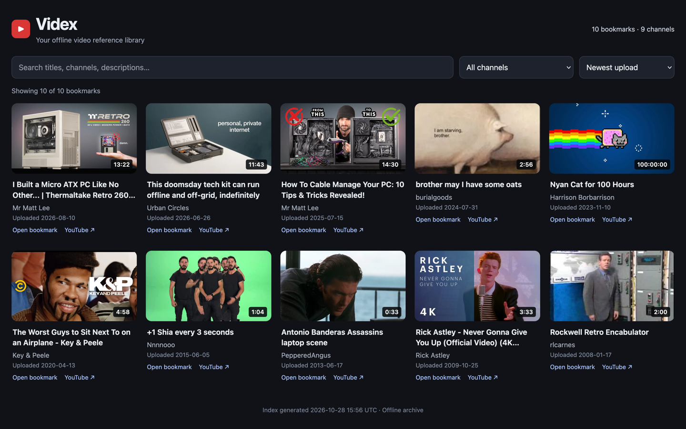
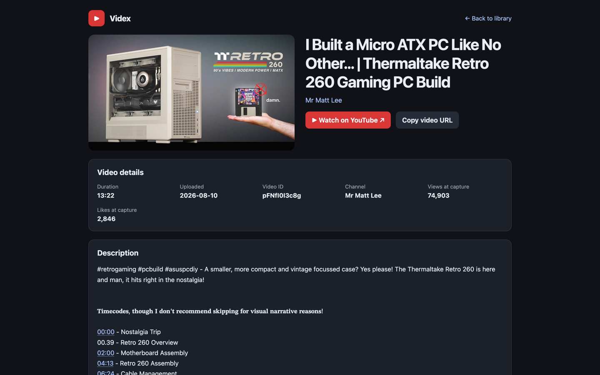

# Videx


**An offline-first video bookmarking and reference library.**

Videx began as a way to keep useful YouTube video references without depending on YouTube's bookmarking interface. It saves **metadata and thumbnails, not video files**, as standalone HTML pages and builds a searchable offline index. The project is currently focused on YouTube and uses [yt-dlp](https://github.com/yt-dlp/yt-dlp) for extraction. Videx is not affiliated with YouTube or Google.

## Screenshots

### Video Library

Browse, search, filter, and sort your saved video references without an internet connection.



### Individual Bookmarks

Each bookmark is a standalone HTML page containing the video's thumbnail, description, metadata, and links to the original video.



## Current features (v0.3.0)

- Save a single video's title, channel, description, chapters, dates, tags, historical counts and thumbnail in a self-contained HTML page.
- Browse a generated `index.html` offline; search by title, channel and description, filter channels, and sort by upload date/title/channel.
- Preserve a curated metadata schema without large extractor manifests (formats, automatic caption manifests, etc.).
- **Prevent duplicate bookmarks by video ID**, even when a video's title or channel changes. Existing IDs are skipped by default.
- **Refresh existing bookmarks with `--overwrite`**, preserving their original filenames and locations.
- **Optionally rebuild the index with `--re-index`** after saving, refreshing or skipping a bookmark; otherwise indexing remains manual.
- **Audit a library for duplicates and ID inconsistencies** using the read-only `yt-bookmark-find.py --audit` command. The detector can recognize renamed bookmarks through their embedded metadata.
- Upgrade previously saved bookmark pages **offline**, with a dry run and backups before applying changes.
- Keep your library outside the source repository using `config.local.json`, or override the destination with `--output`. Without local configuration, the project-relative library remains the fallback.
- Manage personal tags in a separate catalog, with preview-by-default edits, backups, and guarded pruning.
- Tag bookmarks during capture, report personal tags through opt-in lookup/audit output (including JSON), and display tags on offline index cards.

**Limitations:** Videx does not save video playback or transcripts. Original video links may become unavailable. Playlist importing, index tag filtering and collections are **planned**; basic personal catalog tagging is implemented. Capturing or refreshing a bookmark requires internet access; browsing, indexing, upgrading and auditing existing bookmarks work offline.

## Requirements

- **Python 3** (required; see the tested runtime notes below)
- **yt-dlp** (required for capturing or refreshing bookmarks; installed separately and available on `PATH`)
- **Bash** and common POSIX command-line utilities (`find`, `sed`, `mktemp`)
- **Pillow** (optional Python package): reduces embedded thumbnail sizes in the generated index; without it, original thumbnails are used.
- macOS or Linux; no Node.js, database, web server or `jq` required.

Install yt-dlp using its [official installation instructions](https://github.com/yt-dlp/yt-dlp/wiki/Installation), your system package manager, or `python3 -m pip install -U yt-dlp` in a suitable Python environment. Check dependencies with `yt-dlp --version`, `python3 --version`, and `bash --version`. yt-dlp evolves as video sites change; update it if extraction stops working.

**Runtime validation for v0.3.0:** the offline suite and synthetic capture workflows were tested on macOS (Apple Silicon) with CPython **3.15.2** and Apple **Bash 3.2.57**, including captures without tags. Other Python/Bash versions and Linux have not been exercised in this release-validation pass; Linux remains an intended platform, not a separately verified result. No minimum Python version beyond Python 3 has been qualified by a version matrix. Browser rendering and live yt-dlp extraction are separate checks; the offline capture tests use local extractor stubs.

From the repository root, run the complete offline regression suite with:

```bash
python3 -B -m unittest discover -s tests -v
```

Tests use disposable synthetic libraries, never your configured library. The `-B` option suppresses bytecode output. No network, yt-dlp installation, browser, or additional test framework is required.

## Quick start

Clone this repository, then from its root run:

```bash
# View capture options
bash scripts/yt-bookmark.sh --help

# Save a bookmark and update the library index in one command
bash scripts/yt-bookmark.sh --re-index 'https://www.youtube.com/watch?v=VIDEO_ID'
```

Open the generated `index.html` in your browser. Bookmarks are created under `<library>/bookmarks/<channel>/<title> [video-id].html`. The `bookmarks/` folder is created automatically when saving the first video. No server is needed.

Without `--re-index`, bookmark capture does **not** rebuild the index. You can rebuild it separately at any time:

```bash
python3 -B scripts/yt-bookmark-index.py
```

Index generation writes a unique temporary file beside `index.html`, then atomically replaces the index. Existing regular-file permissions are preserved; new indexes and replaced symlinks use normal creation permissions respecting the process umask, without writing through symlinks. Concurrent builds publish complete files; the last successful replacement wins.

Rebuilding the index automatically embeds normalized personal tags from the selected library's `catalog.json` and displays them as wrapping badges on bookmark cards. Tags are display-only: search, channel filters, and sorting are unchanged, and `hidden` remains visible. Missing catalogs or tag records produce no tag row; orphan records are ignored. Malformed, unreadable, symlinked, or non-regular catalogs cause exit status `2` before index writing, even when no valid bookmarks exist, leaving any existing index and its permissions untouched. Bookmark files and catalog data are never rewritten. Existing indexes show tags only after rebuilding and remain self-contained offline.

### Bookmark management

```bash
# Save a bookmark without rebuilding the index
bash scripts/yt-bookmark.sh 'https://youtu.be/VIDEO_ID'

# Save into another library and rebuild its index
bash scripts/yt-bookmark.sh --output '/path/to/library' --re-index 'https://youtu.be/VIDEO_ID'

# Refresh an existing bookmark in place, preserving its path
bash scripts/yt-bookmark.sh --overwrite 'https://youtu.be/VIDEO_ID'

# Refresh a bookmark and rebuild the index afterward
bash scripts/yt-bookmark.sh --overwrite --re-index 'https://youtu.be/VIDEO_ID'

# Rebuild the index of another library without capturing a bookmark
python3 -B scripts/yt-bookmark-index.py '/path/to/library'
```

Capture accepts repeated `--tag` options. New bookmarks receive their requested tags automatically in `catalog.json`; existing bookmarks preview tag changes unless `--apply` is supplied. `--overwrite` independently refreshes the bookmark HTML; `--apply` controls existing-bookmark tag changes only.

```bash
# New bookmark: save both tags automatically; existing bookmark: preview additions
bash scripts/yt-bookmark.sh --tag Python --tag Research 'https://youtu.be/AAAAAAAAAAA'

# Existing bookmark: apply tag additions without refreshing its HTML
bash scripts/yt-bookmark.sh --tag Research --apply 'https://youtu.be/AAAAAAAAAAA'

# Refresh existing HTML and apply requested tag additions
bash scripts/yt-bookmark.sh --overwrite --tag Research --apply 'https://youtu.be/AAAAAAAAAAA'
```

Requested tags use the tag utility's normalization and validation: whitespace is collapsed, duplicates are compared case-insensitively, and normalized tags must be nonempty, at most 80 characters, and free of control characters. Tagged capture validates tags and catalog state before extraction and rechecks the catalog before a bookmark write. Invalid inputs leave existing bookmarks/catalogs unchanged. Untagged capture does not read the catalog unless `--re-index` is requested.

Videx identifies existing bookmarks by **video ID**, rather than their title or channel directory. An existing ID is skipped by default; adding `--re-index` still rebuilds the index after a skip. With `--overwrite`, Videx refreshes the matching HTML file at its existing path instead of creating a renamed copy. If multiple matches are found, Videx refuses to choose one automatically.

Video IDs are case-sensitive 11-character strings containing letters, digits, `_` or `-`. A filename ID must agree with embedded metadata. Renamed bookmarks use their metadata ID; legacy filename-only bookmarks remain supported by lookup and tagging only when the metadata element is absent. Present but malformed metadata never falls back to the filename. Lookup and catalog changes refuse conflicting, ambiguous, or incomplete inventories (status `2`); capture stops on lookup failure and validates the extractor's unchanged ID before writing. Indexing and offline upgrades warn and skip damaged or conflicting pages, including legacy pages lacking the metadata they require. Audit reports conflicts separately from resolved IDs. No identity is automatically repaired.

Capture also checks the entire bookmark inventory before extraction and again before writing, rejecting duplicate IDs anywhere in the collection under the same rules as catalog mutations. Embedded and incoming metadata JSON reject repeated `id` keys even when their values match; other repeated keys retain their existing last-value behavior.

The `--output` argument always specifies a **library root**, not its `bookmarks/` subdirectory. The library's bookmarks live under `<library>/bookmarks/`, and its index is `<library>/index.html`.

### Personal catalog management

`yt-bookmark-tag.py` supports `add`, `remove`, `set`, `rename`, `list`, `report`, and `prune`. Editing operations preview changes by default; repeat with `--apply` to save. Applied changes back up an existing catalog before replacement. Examples below use the configured library (or project-local fallback):

```bash
python3 -B scripts/yt-bookmark-tag.py add AAAAAAAAAAA Python Research
python3 -B scripts/yt-bookmark-tag.py add AAAAAAAAAAA Python Research --apply
python3 -B scripts/yt-bookmark-tag.py remove AAAAAAAAAAA Research
python3 -B scripts/yt-bookmark-tag.py set AAAAAAAAAAA Reference
python3 -B scripts/yt-bookmark-tag.py rename Reference Research
python3 -B scripts/yt-bookmark-tag.py list AAAAAAAAAAA
python3 -B scripts/yt-bookmark-tag.py report
python3 -B scripts/yt-bookmark-tag.py prune
```

`remove` removes the requested tags; `set` replaces all personal tags for that video (with no tag arguments, it previews clearing them). `rename` previews replacement across matching library bookmarks. `list` and `report` are read-only. `prune` previews removal of catalog entries without matching bookmarks and refuses incomplete inventories; it never deletes bookmark HTML. None of these commands rebuilds the index automatically.

Place an explicit library root before the operation to override configuration:

```bash
python3 -B scripts/yt-bookmark-tag.py '/path/to/library' add AAAAAAAAAAA Research --apply
```

### Library integrity audit

Use the standalone helper to inspect an existing library without modifying its files:

```bash
# Audit the project library
python3 -B scripts/yt-bookmark-find.py . --audit

# Audit a separate library
python3 -B scripts/yt-bookmark-find.py '/path/to/library' --audit
```

The audit scans the selected library's `bookmarks/` tree and reports:

- **DUPLICATE:** more than one bookmark with the same video ID.
- **MISMATCH:** a video ID in the filename disagrees with its embedded metadata.
- **UNKNOWN:** no valid video ID can be identified.
- **UNREADABLE:** a file cannot be read or its metadata cannot be parsed.

It summarizes scanned files, unique video IDs, duplicate groups, extra copies and other findings. A clean audit exits with status `0`; detected issues return `1`; invalid arguments or a missing bookmarks directory return `2`. **The audit is read-only**: it does not rename, delete or repair files.

### Personal tags in lookup and audit reports

Add `--show-tags` to include personal tags from the selected library's `catalog.json`. Without this flag, lookup still prints only the matching path and never reads the catalog. The existing `yt-bookmark-tag.py report` command remains available.

```bash
python3 -B scripts/yt-bookmark-find.py '/path/to/library' --id AAAAAAAAAAA --show-tags
python3 -B scripts/yt-bookmark-find.py '/path/to/library' --audit --show-tags
python3 -B scripts/yt-bookmark-find.py '/path/to/library' --audit --show-tags --json
```

Human lookup reports show `Bookmark:`, `Video ID:`, and `Tags: ["Python", "Research"]`. Human audit reports retain identity findings and append personal tags, grouping duplicate paths under their resolved ID. Conflicting identities are never assigned tags, and `hidden` does not filter results.

`--json` requires `--show-tags` and emits one JSON document with `report_version: 1`, `operation`, `library`, `catalog.status`, `bookmarks` (`id`, absolute `paths`, `tags`), `issues`, and `exit_status`. Audit JSON also includes `summary` counts. Catalog status is `present`, `missing`, `unavailable`, or `not_read`. Missing catalogs/records yield empty tag lists and are never created. Tag whitespace, case-insensitive deduplication, and `hidden` normalization match the tag utility; catalog contents are not changed.

Malformed, unreadable, symlinked, or non-regular catalogs produce status `2`. JSON retains any audit findings, includes a `CATALOG_ERROR` issue, and represents unavailable tags as `null`, not `[]`; human reports explain the error on stderr. Lookup failures (`1` not found, `2` unsafe/invalid, `3` URL needs extraction) do not read the catalog. Default lookup/audit behavior and exit codes remain unchanged. Argument syntax errors still use normal argparse diagnostics.

### Offline bookmark upgrades

```bash
# Inspect possible upgrades without changing files
python3 -B scripts/yt-bookmark-upgrade.py

# Apply upgrades; originals are copied to a timestamped sibling backup folder
python3 -B scripts/yt-bookmark-upgrade.py --apply

# Rebuild the index after upgrading
python3 -B scripts/yt-bookmark-index.py
```

The upgrade tool works entirely offline. Inspect its dry-run output before applying changes and retain backups until you verify the results. Index generation requires at least one valid bookmark.

## Separate library configuration

Videx source code and personal bookmark data can live in different folders. Copy `config.example.json` to `config.local.json` in the project root, then edit it:

```json
{
  "library": "~/Documents/Video Bookmarks"
}
```

`config.local.json` is ignored by Git. The `library` value must be an absolute path or begin with `~/`, and must point to the **library root**, not `bookmarks/`. When the file is absent, Videx falls back to its original project-local library. An invalid configuration fails with an error instead of silently selecting another location. Explicit paths still override the configured default.

Commands with a configured default:

```bash
bash scripts/yt-bookmark.sh --re-index 'https://youtu.be/VIDEO_ID'
python3 -B scripts/yt-bookmark-index.py
python3 -B scripts/yt-bookmark-find.py --audit
python3 -B scripts/yt-bookmark-tag.py report
python3 -B scripts/yt-bookmark-upgrade.py
```

The tag tool also accepts its original `LIBRARY OPERATION ...` syntax; `yt-bookmark.sh --output DIR` and positional directory arguments on the other utilities continue to override the default. The generator and metadata helper accept explicit file arguments and need no configuration.

`python3 -B scripts/yt-bookmark-tag.py prune` previews catalog entries without matching bookmarks; add `--apply` to remove them, backing up the catalog first. Both modes refuse with status `2` if the `bookmarks/` inventory is incomplete: unreadable files or directories, malformed metadata, unidentified bookmarks, or symbolic links. Generated `index.html` files are excluded. Resolve the reported paths before retrying; refusal leaves the catalog and backups untouched.

### Moving an existing collection

1. Back up your current library before moving anything. Quit any programs editing the files.
2. Create a directory for your external library, such as `~/Documents/Video Bookmarks/`. Move **the entire `bookmarks/` directory**, `catalog.json`, any `catalog.json.bak-*` files, and `index.html` from the project root into it. Do not move scripts or Git files.
3. Update `config.local.json` to point to your chosen library root.
4. Verify `python3 -B scripts/yt-bookmark-find.py --audit`, then regenerate with `python3 -B scripts/yt-bookmark-index.py`. Open the new `index.html` and test an existing bookmark's Back to Library link.
5. Only after verification, remove obsolete project-local generated index or bookmark copies. Keep your backup until you are satisfied. Do not keep two active libraries with the same bookmarks.

**Important:** The `--output` flag on the capture script creates the target library directory if needed. Check the configured path carefully before your first capture. The offline index and audit commands will not create missing bookmark directories.

## Project layout

```text
videx/
├── scripts/
│   ├── yt-bookmark.sh            # Capture bookmarks and optionally rebuild the index
│   ├── yt-bookmark-find.py       # Video-ID lookup and read-only library audit
│   ├── yt-bookmark-tag.py        # Personal catalog management and tag reports
│   ├── yt-bookmark-generate.py   # Render standalone HTML
│   ├── yt-bookmark-metadata.py   # Curate stable metadata (schema v2)
│   ├── yt-bookmark-index.py      # Generate searchable offline index
│   ├── yt-bookmark-upgrade.py    # Offline migration and backups
│   ├── videx_config.py          # Configured/default library resolution
│   └── videx_identity.py        # Shared identity and metadata JSON validation
├── tests/                       # Offline regressions with synthetic fixtures
├── config.example.json          # Sample library path (tracked)
├── config.local.json            # Personal default library path (Git-ignored)
└── .gitignore
```

Individual bookmarks remain readable on their own. Their embedded thumbnail and curated metadata do not require a network connection; external links do. The back-to-library link assumes the bookmark remains in the indexed archive tree.

The generator accepts explicit metadata, thumbnail, and output paths as a lower-level tool. Metadata curation, configuration resolution, and identity validation are supporting helpers; normal workflows use the capture, find, tag, index, and upgrade commands above.

## Bookmark storage and backups

Videx stores bookmarks locally as standalone HTML files in the selected library’s `bookmarks/` directory. The generated `index.html` provides an offline-searchable interface to your collection.

These files are excluded from Git tracking by default. Your bookmark collection is independent of the Videx source code, so be sure to back it up separately. Duplicate detection and auditing do not replace backups.

## Project history and roadmap

**Origin:** A simple local alternative to YouTube's bookmark/playlist front end. The first iteration generated a self-contained HTML page for each saved video.

**Current state (v0.3.0):** A small suite of scripts with channel-organized bookmarks, curated metadata, a separate personal-tag catalog, capture tagging, opt-in text/JSON tag reports, and catalog-aware offline index cards. Identity checks, duplicate prevention, in-place refreshes, offline upgrades, previews and backups preserve existing formats. The original `yt-bookmark-*` script names are retained intentionally.

### v0.3.0 release notes

- Added personal catalog management and repeatable capture tags, with preview/apply behavior for existing bookmarks.
- Added opt-in lookup/audit tag reports and JSON output without changing unflagged lookup output.
- Added normalized personal-tag badges to the self-contained offline index. Tags are display-only; `hidden` is not excluded.
- Hardened bookmark identity validation, repeated JSON `id` detection, inventory traversal, pruning, and atomic index publication.
- Capture now rejects invalid requested tags or applicable catalog state before bookmark writes, including refreshes. Untagged capture is covered on Apple Bash 3.2.57.

Compatibility: catalog schema **1**, bookmark metadata schema **2**, and JSON report version **1** are unchanged. No automatic library migration or recapture is required. Legacy filename-only bookmarks remain usable for lookup/tagging; indexing/upgrading still require embedded metadata. Rebuild the index explicitly to display catalog tags.

**Future work (not included in v0.3.0):**

1. Import all accessible entries from a YouTube playlist as individual bookmarks, using the existing video-ID checks to skip duplicates and reporting failures.
2. Collections for curated browsing, with bookmarks belonging to multiple collections.
3. Personal-tag search/filtering and visual collection browsing in the index.
4. An explicit hidden-item display policy; current `hidden` tags remain ordinary visible tags.

Longer-term possibilities include better batch management and a unified `videx` command, if the existing tools become cumbersome. These are ideas, not commitments.

## License

MIT — see [LICENSE](LICENSE). [yt-dlp](https://github.com/yt-dlp/yt-dlp) is an external dependency with its own license; it is not bundled with Videx.
