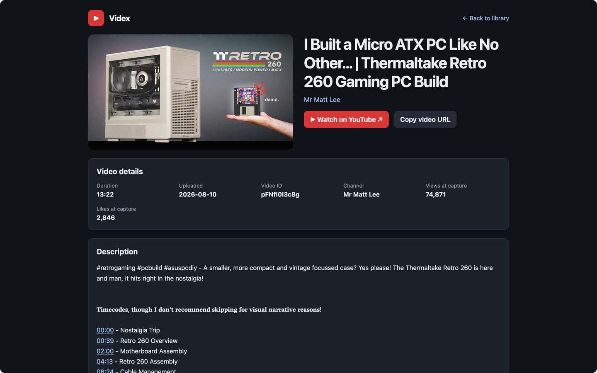

# Videx


**An offline-first video bookmarking and reference library.**

Videx saves YouTube **metadata and thumbnails, not video files**, as standalone HTML bookmarks and builds a searchable local index. Keep useful video references without depending on YouTube's bookmarking interface, and browse saved descriptions, chapters, and metadata offline. Original video links may become unavailable; Videx does not preserve playback or transcripts.

The project currently focuses on YouTube and uses [yt-dlp](https://github.com/yt-dlp/yt-dlp) for extraction. Videx is not affiliated with YouTube or Google.

## Screenshots

### Video Library

Browse, search, filter channels, and sort saved references offline.


### Individual Bookmarks

Each standalone page contains a thumbnail, description, metadata, and links to the original video.



## Current features

- Save titles, channels, descriptions, chapters, dates, source tags, historical counts, and thumbnails in self-contained HTML pages.
- Search the offline index by title, channel, description, video ID, or personal tags; filter channels and sort by upload date, title, or channel.
- Prevent duplicate captures by video ID, recognize renamed bookmarks through embedded metadata, and refresh existing bookmarks at their original paths.
- Manage personal tags in a separate catalog, add tags during capture, and show searchable tag badges on index cards.
- Audit identities and duplicates without changing files, with optional personal-tag and JSON reports.
- Upgrade saved bookmark pages offline, using previews and backups, and keep your library outside the source repository.

Playlist importing, collections, and dedicated index tag filtering remain future work. Personal tagging and tag searching are implemented; see the [development history and roadmap](docs/DEVELOPMENT.md#future-roadmap) for context.

## Requirements

- **Python 3**, **Bash**, and common POSIX utilities (`find`, `sed`, `mktemp`).
- **yt-dlp**, installed separately and available on `PATH`, for capture and refresh.
- **Pillow**, optionally, to reduce embedded index thumbnail sizes; otherwise original thumbnails are used.
- macOS or Linux; no Node.js, database, web server, or `jq` required. Linux is an intended platform; see the [recorded runtime validation](docs/DEVELOPMENT.md#testing-and-recorded-runtime-validation) for tested environments. No minimum Python version beyond Python 3 has been qualified.

Install yt-dlp using its [official instructions](https://github.com/yt-dlp/yt-dlp/wiki/Installation), your package manager, or `python3 -m pip install -U yt-dlp` in a suitable Python environment. Check `yt-dlp --version`, `python3 --version`, and `bash --version`. Update yt-dlp if site changes break extraction.

## Quick start

Clone this repository and work from its root. Before capturing, choose your library location. Copy `config.example.json` to `config.local.json` and edit it, for example:

```json
{
  "library": "~/Documents/Video Bookmarks"
}
```

This local configuration is ignored by Git. Use an absolute path or one beginning with `~/`, pointing to the **library root**, not its `bookmarks/` subdirectory. Without configuration, Videx uses the project root; invalid configuration fails rather than silently choosing another location. Explicit command paths override the configured default.

```text
<library>/
├── bookmarks/    # Standalone saved HTML bookmarks
├── catalog.json # Personal catalog data, created when needed
└── index.html   # Generated offline index
```

View capture options, then save a bookmark and rebuild the index. Replace `AAAAAAAAAAA` with a real 11-character video ID:

```bash
bash scripts/yt-bookmark.sh --help
bash scripts/yt-bookmark.sh --re-index 'https://www.youtube.com/watch?v=AAAAAAAAAAA'
```

Open `<library>/index.html` in your browser; no server is needed. Capture creates `bookmarks/` automatically and saves new pages under `<library>/bookmarks/<channel>/<title> [video-id].html`. The catalog is separate from embedded source metadata; rebuilding the index reads saved data without recapturing it.

## Essential commands

These examples use the configured library or project-local fallback. Tag edits require an existing bookmark with the indicated ID. Full options, explicit-path examples, and unusual argument syntax are in [Usage](docs/USAGE.md).

```bash
# Capture without rebuilding the index
bash scripts/yt-bookmark.sh 'https://youtu.be/AAAAAAAAAAA'

# Refresh an existing bookmark and rebuild the index
bash scripts/yt-bookmark.sh --overwrite --re-index 'https://youtu.be/AAAAAAAAAAA'

# Rebuild the index independently, offline
python3 -B scripts/yt-bookmark-index.py

# New bookmark: tags save automatically; existing bookmark: preview additions
bash scripts/yt-bookmark.sh --tag Python --tag Research 'https://youtu.be/AAAAAAAAAAA'

# Preview, then apply personal tags to an existing bookmark
python3 -B scripts/yt-bookmark-tag.py add AAAAAAAAAAA Python Research
python3 -B scripts/yt-bookmark-tag.py add AAAAAAAAAAA Python Research --apply

# Inspect tag totals and audit the library without modifying it
python3 -B scripts/yt-bookmark-tag.py report
python3 -B scripts/yt-bookmark-find.py --audit

# Preview offline upgrades, then apply with backups
python3 -B scripts/yt-bookmark-upgrade.py
python3 -B scripts/yt-bookmark-upgrade.py --apply

# Rebuild after upgrades or applied tag changes
python3 -B scripts/yt-bookmark-index.py
```

The tag tool also supports removing, replacing, and renaming tags, catalog-only listing, and previewing orphan-record pruning. Audit reports duplicates, mismatches, unknown identities, and unreadable files; it does not repair them. Inspect warnings before applying maintenance operations.

## Important usage cautions

- **Internet:** Capture and refresh need internet access. Browsing, indexing, tagging, auditing, and upgrades work offline; external video links still require a connection.
- **Destination:** Capture `--output DIR` selects a library root and can create directories. Check the configured or explicit path before your first capture. Index and audit commands do not create missing bookmark directories.
- **Existing bookmarks:** Existing IDs are skipped by default, even after title/channel changes. `--overwrite` refreshes HTML at its existing path; ambiguous matches are refused.
- **Preview versus writes:** Catalog edits and upgrades preview by default; `--apply` saves those changes. Capture writes new bookmarks and automatically saves their requested tags. For existing capture tags, `--apply` controls tag edits independently of HTML refresh with `--overwrite`.
- **Index updates:** Capture rebuilds only with `--re-index`, including after a skip. Rebuild explicitly after upgrades, applied catalog/visibility changes, or index search-code updates. Tag commands never rebuild automatically.
- **Visibility:** The normalized personal tag `hidden` excludes a bookmark from the rebuilt index, not from files, catalogs, or CLI reports. It is no security feature. Older copies may contain hidden entries; failed rebuilds retain the existing index.
- **Backups:** Back up your library independently of the source repository. Generated library files are ignored by Git by default. Duplicate checks and audits do not replace backups; retain upgrade/catalog backups until verified.

## Documentation

- [Usage](docs/USAGE.md) — Detailed commands, configuration, tag workflows, reports, moving libraries, and troubleshooting.
- [Development](docs/DEVELOPMENT.md) — Architecture, modules, testing, runtime validation, history, historical release notes, and roadmap.
- [Data formats](docs/DATA_FORMATS.md) — Library layout, metadata, catalog and report schemas, identity, normalization, and compatibility.
- [Safety](docs/SAFETY.md) — Filesystem checks, validation, backups, publication, failure statuses, and concurrency limits.

## License

MIT — see [LICENSE](LICENSE). [yt-dlp](https://github.com/yt-dlp/yt-dlp) is an external dependency with its own license; it is not bundled with Videx.
