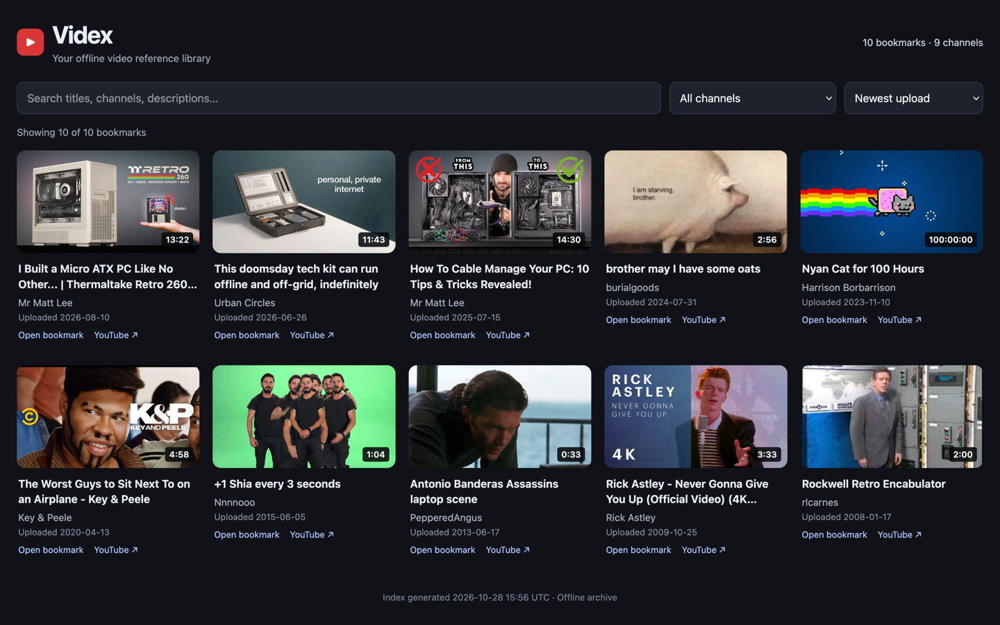
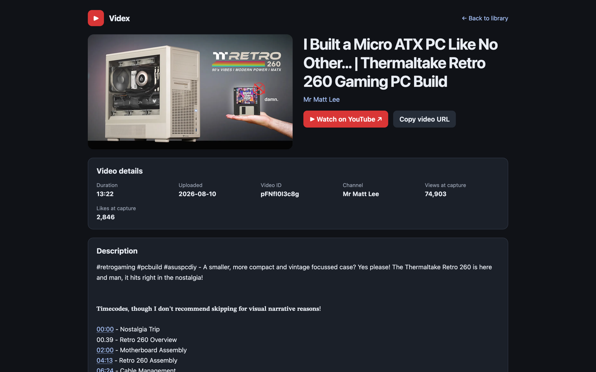

# Videx


**An offline-first video bookmarking and reference library.**

Videx began as a way to keep useful YouTube video references without depending on YouTube's bookmarking interface. It saves **metadata and thumbnails, not video files**, as standalone HTML pages and builds a searchable offline index. The project is currently focused on YouTube and uses [yt-dlp](https://github.com/yt-dlp/yt-dlp) for extraction. Videx is not affiliated with YouTube or Google.

## Screenshots

### Video Library

Browse, search, filter, and sort your saved video references without an internet connection.



### Individual Bookmarks

Each bookmark is a standalone HTML page containing the video's thumbnail, description, metadata, and links to the original video.



## Current features (v0.2.0)

- Save a single video's title, channel, description, chapters, dates, tags, historical counts and thumbnail in a self-contained HTML page.
- Browse a generated `index.html` offline; search by title, channel and description, filter channels, and sort by upload date/title/channel.
- Preserve a curated metadata schema without large extractor manifests (formats, automatic caption manifests, etc.).
- **Prevent duplicate bookmarks by video ID**, even when a video's title or channel changes. Existing IDs are skipped by default.
- **Refresh existing bookmarks with `--overwrite`**, preserving their original filenames and locations.
- **Optionally rebuild the index with `--re-index`** after saving, refreshing or skipping a bookmark; otherwise indexing remains manual.
- **Audit a library for duplicates and ID inconsistencies** using the read-only `yt-bookmark-find.py --audit` command. The detector can recognize renamed bookmarks through their embedded metadata.
- Upgrade previously saved bookmark pages **offline**, with a dry run and backups before applying changes.
- Keep your library in the project-relative `bookmarks/` directory or specify another library root with `--output`.

**Limitations:** Videx does not save video playback or transcripts. Original video links may become unavailable. Playlist importing, personal tags and collections are **planned, not yet implemented**. Capturing or refreshing a bookmark requires internet access; browsing, indexing, upgrading and auditing existing bookmarks work offline.

## Requirements

- **Python 3** (required)
- **yt-dlp** (required for capturing or refreshing bookmarks; installed separately and available on `PATH`)
- **Bash** and common POSIX command-line utilities (`find`, `sed`, `mktemp`)
- **Pillow** (optional Python package): reduces embedded thumbnail sizes in the generated index; without it, original thumbnails are used.
- macOS or Linux; no Node.js, database, web server or `jq` required.

Install yt-dlp using its [official installation instructions](https://github.com/yt-dlp/yt-dlp/wiki/Installation), your system package manager, or `python3 -m pip install -U yt-dlp` in a suitable Python environment. Check dependencies with `yt-dlp --version`, `python3 --version`, and `bash --version`. yt-dlp evolves as video sites change; update it if extraction stops working.

## Quick start

Clone this repository, then from its root run:

```bash
# View capture options
bash scripts/yt-bookmark.sh --help

# Save a bookmark and update the library index in one command
bash scripts/yt-bookmark.sh --re-index 'https://www.youtube.com/watch?v=VIDEO_ID'
```

Open the generated `index.html` in your browser. Bookmarks are created under `bookmarks/<channel>/<title> [video-id].html`. The `bookmarks/` folder is created automatically when saving the first video. No server is needed.

Without `--re-index`, bookmark capture does **not** rebuild the index. You can rebuild it separately at any time:

```bash
python3 -B scripts/yt-bookmark-index.py
```

### Bookmark management

```bash
# Save a bookmark without rebuilding the index
bash scripts/yt-bookmark.sh 'https://youtu.be/VIDEO_ID'

# Save into another library and rebuild its index
bash scripts/yt-bookmark.sh --output '/path/to/library' --re-index 'https://youtu.be/VIDEO_ID'

# Refresh an existing bookmark in place, preserving its path
bash scripts/yt-bookmark.sh --overwrite 'https://youtu.be/VIDEO_ID'

# Refresh a bookmark and rebuild the index afterward
bash scripts/yt-bookmark.sh --overwrite --re-index 'https://youtu.be/VIDEO_ID'

# Rebuild the index of another library without capturing a bookmark
python3 -B scripts/yt-bookmark-index.py '/path/to/library'
```

Videx identifies existing bookmarks by **video ID**, rather than their title or channel directory. An existing ID is skipped by default; adding `--re-index` still rebuilds the index after a skip. With `--overwrite`, Videx refreshes the matching HTML file at its existing path instead of creating a renamed copy. If multiple matches are found, Videx refuses to choose one automatically.

The `--output` argument always specifies a **library root**, not its `bookmarks/` subdirectory. The library's bookmarks live under `<library>/bookmarks/`, and its index is `<library>/index.html`.

### Library integrity audit

Use the standalone helper to inspect an existing library without modifying its files:

```bash
# Audit the project library
python3 -B scripts/yt-bookmark-find.py . --audit

# Audit a separate library
python3 -B scripts/yt-bookmark-find.py '/path/to/library' --audit
```

The audit scans the selected library's `bookmarks/` tree and reports:

- **DUPLICATE:** more than one bookmark with the same video ID.
- **MISMATCH:** a video ID in the filename disagrees with its embedded metadata.
- **UNKNOWN:** no valid video ID can be identified.
- **UNREADABLE:** a file cannot be read or its metadata cannot be parsed.

It summarizes scanned files, unique video IDs, duplicate groups, extra copies and other findings. A clean audit exits with status `0`; detected issues return `1`; invalid arguments or a missing bookmarks directory return `2`. **The audit is read-only**: it does not rename, delete or repair files.

### Offline bookmark upgrades

```bash
# Inspect possible upgrades without changing files
python3 -B scripts/yt-bookmark-upgrade.py

# Apply upgrades; originals are copied to a timestamped sibling backup folder
python3 -B scripts/yt-bookmark-upgrade.py --apply

# Rebuild the index after upgrading
python3 -B scripts/yt-bookmark-index.py
```

The upgrade tool works entirely offline. Inspect its dry-run output before applying changes and retain backups until you verify the results. Index generation requires at least one valid bookmark.

## Project layout

```text
videx/
├── scripts/
│   ├── yt-bookmark.sh            # Capture bookmarks and optionally rebuild the index
│   ├── yt-bookmark-find.py       # Video-ID lookup and read-only library audit
│   ├── yt-bookmark-generate.py   # Render standalone HTML
│   ├── yt-bookmark-metadata.py   # Curate stable metadata (schema v2)
│   ├── yt-bookmark-index.py      # Generate searchable offline index
│   └── yt-bookmark-upgrade.py    # Offline migration and backups
├── bookmarks/                   # Personal library; Git-ignored
└── index.html                   # Generated dashboard; Git-ignored
```

Individual bookmarks remain readable on their own. Their embedded thumbnail and curated metadata do not require a network connection; external links do. The back-to-library link assumes the bookmark remains in the indexed archive tree.

## Bookmark storage and backups

Videx stores bookmarks locally as standalone HTML files in the `bookmarks/` directory. The generated `index.html` provides an offline-searchable interface to your collection.

These files are excluded from Git tracking by default. Your bookmark collection is independent of the Videx source code, so be sure to back it up separately. Duplicate detection and auditing do not replace backups.

## Project history and roadmap

**Origin:** A simple local alternative to YouTube's bookmark/playlist front end. The first iteration generated a self-contained HTML page for each saved video.

**Current state (v0.2.0):** A small suite of independent scripts, a channel-organized archive, curated metadata, a searchable offline index, an offline upgrade workflow, video-ID duplicate prevention, in-place refreshes, optional index rebuilding and a read-only integrity audit. The original `yt-bookmark-*` script names are retained intentionally.

**Next iteration (not implemented):**

1. Import all accessible entries from a YouTube playlist as individual bookmarks, using the existing video-ID checks to skip duplicates and reporting failures.
2. Maintain one central archive with **personal tags** for topical searching and **collections** for curated browsing; a bookmark may belong to multiple collections.
3. Keep uploader tags separate from personal tags, and store user classifications in a catalog independent of generated HTML.
4. Extend the index with tag/collection filtering and visual collection browsing.

Longer-term possibilities include better batch management and a unified `videx` command, if the existing tools become cumbersome. These are ideas, not commitments.

## License

MIT — see [LICENSE](LICENSE). [yt-dlp](https://github.com/yt-dlp/yt-dlp) is an external dependency with its own license; it is not bundled with Videx.
